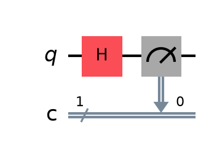
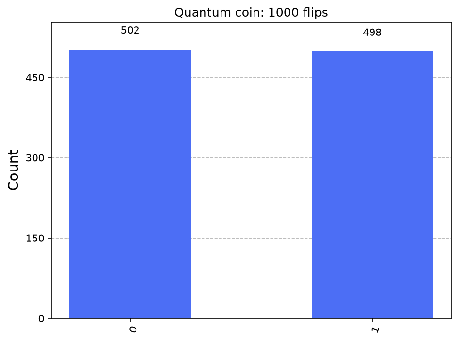

# Project 1: Quantum coin flip and random number generator

## What it shows
One qubit in superposition behaves like a perfectly fair coin. The script flips it 1,000 times, then uses 8 qubits to make a random number from 0 to 255 and rolls a quantum dice.

## The physics, simply
A qubit can be 0, 1, or a superposition of both at once. The Hadamard (H) gate turns a qubit that starts at 0 into an equal superposition of 0 and 1. Measuring a qubit forces it to pick one answer, and in this state each answer has a 50% chance. Quantum mechanics says this outcome is fundamentally unpredictable, which is why real quantum hardware can be used as a true random number generator. On a laptop simulator the randomness comes from a normal computer's random number generator, so the real "true randomness" only happens on real quantum hardware (see project 06).

## How to run it
From this folder, with your virtual environment active (see [SETUP_GUIDE.md](../SETUP_GUIDE.md)):

```
python coin_flip.py          (1,000 flips)
python coin_flip.py 5000     (choose your own number of flips)
```

The script prints the results and saves circuit.png, histogram.png in this folder.

## Expected output
Roughly half heads (0) and half tails (1), a heads ratio close to 0.500, plus a random 8-bit number and a dice roll that change every run.

## A real run (Qiskit 2.6.1, Qiskit Aer 0.18.0 simulator, 1,024 shots unless stated)
```
1000 quantum coin flips -> heads (0): 502, tails (1): 498
Heads ratio: 0.502  (a fair coin should be close to 0.500)
Random 8-bit number: 203  (bits: 11001011)
Quantum dice roll: 4
```
Your numbers will differ slightly each run, because measurement is random. The full terminal output, circuit included, is in `run_output.txt`.





## Try this next
Use 4 qubits and the same "throw away and retry" trick as the dice to pick a random winner from a list of 10 names. Then run it on real IBM hardware and compare the counts with the simulator.

## Post it
See [caption.md](caption.md).
