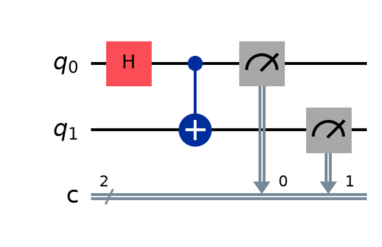

# Project 2: Bell state and entanglement

## What it shows
Two experiments side by side. Two independent random qubits give all four answers (00, 01, 10, 11). Two entangled qubits only ever give 00 or 11: they always agree.

## The physics, simply
Entanglement links two qubits so that their measurement results are correlated, even though each result on its own is random. The circuit puts qubit 0 in superposition with an H gate, then a CNOT gate flips qubit 1 only when qubit 0 is 1. This creates the Bell state (|00> + |11>)/√2: "both 0" and "both 1" at the same time, and nothing else. When you measure, you get 00 or 11 at random, but never 01 or 10. Entanglement is the resource behind teleportation, many quantum algorithms, and quantum cryptography.

## How to run it
From this folder, with your virtual environment active (see [SETUP_GUIDE.md](../SETUP_GUIDE.md)):

```
python bell_state.py
```

The script prints the results and saves circuit.png, histogram.png in this folder.

## Expected output
Independent qubits: about 25% for each of 00, 01, 10, 11. Entangled qubits: about 50% 00 and 50% 11, and agreement in 100% of shots.

## A real run (Qiskit 2.6.1, Qiskit Aer 0.18.0 simulator, 1,024 shots unless stated)
```
Independent qubits: {'00': 277, '01': 238, '10': 263, '11': 246}
Entangled (Bell) qubits: {'00': 533, '11': 491}
Entangled qubits agreed in 1024/1024 shots (100.0%)
```
Your numbers will differ slightly each run, because measurement is random. The full terminal output, circuit included, is in `run_output.txt`.




## Try this next
Make the other three Bell states by adding an X gate and/or a Z gate. Try adding an H gate on both qubits just before measuring: which outcomes appear now, and why?

## Post it
See [caption.md](caption.md).
