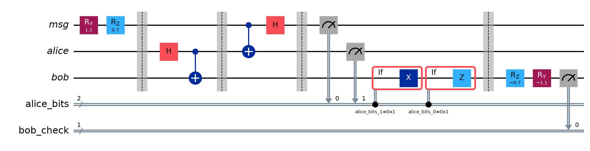
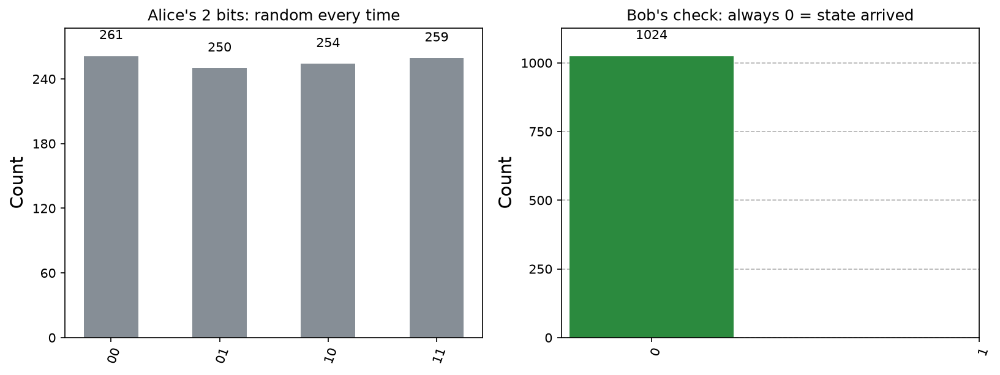

# Project 3: Quantum teleportation

## What it shows
Alice sends the exact state of one qubit to Bob using a shared entangled pair and two ordinary bits. To prove it worked, Bob undoes the state he should have received. If teleportation worked, he reads 0 every time.

## The physics, simply
You cannot copy an unknown quantum state (the no-cloning rule), but you can move it. Alice and Bob first share an entangled Bell pair (project 2). Alice combines her mystery qubit with her half of the pair and measures both, which gives two random classical bits. She sends those two bits to Bob by a normal channel, and he uses them to choose a correction: an X gate, a Z gate, both, or nothing. Bob's qubit then holds Alice's original state, and her copy is destroyed by her measurement. Because the two bits travel normally, nothing moves faster than light.

## How to run it
From this folder, with your virtual environment active (see [SETUP_GUIDE.md](../SETUP_GUIDE.md)):

```
python teleportation.py
```

The script prints the results and saves circuit.png, histogram.png in this folder.

## Expected output
Alice's two bits are random (about 25% each for 00, 01, 10, 11). Bob's check gives 0 in every shot, a 100% success rate.

## A real run (Qiskit 2.6.1, Qiskit Aer 0.18.0 simulator, 1,024 shots unless stated)
```
Alice's two measured bits (random): {'00': 261, '01': 250, '10': 254, '11': 259}
Bob's check after undoing the state: {'0': 1024, '1': 0}
Teleportation success rate: 100.0%
```
Your numbers will differ slightly each run, because measurement is random. The full terminal output, circuit included, is in `run_output.txt`.





## Try this next
Delete the two if_test correction blocks and run it again. Bob's success rate should drop, which shows the classical bits really matter. Then try different THETA and PHI angles.

## Post it
See [caption.md](caption.md).
