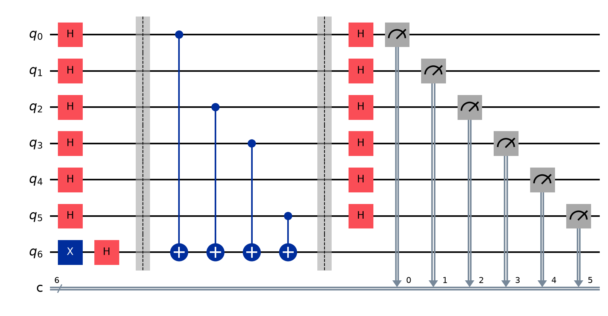
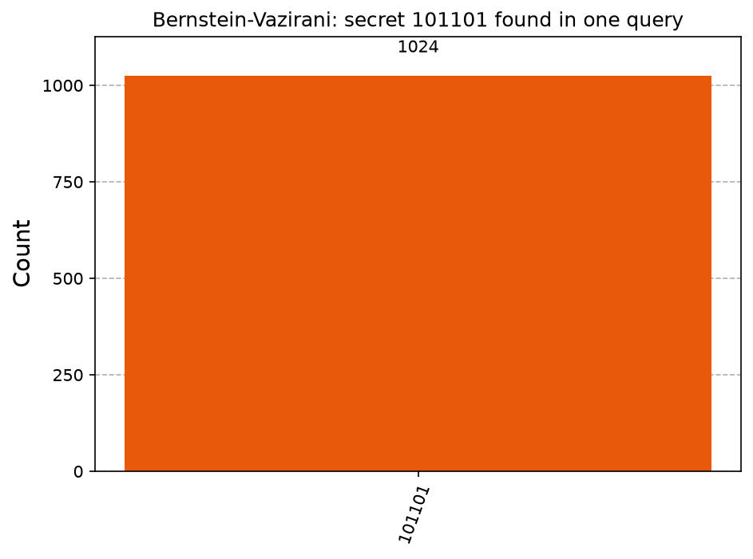

# Project 4: Bernstein-Vazirani, a first quantum speedup

## What it shows
A black box hides a secret bitstring. A classical program needs one question per bit to find it (6 questions for 6 bits). The quantum circuit finds the whole secret with a single question.

## The physics, simply
The black box (an "oracle") takes a bitstring x and answers (s · x) mod 2, where s is the secret. A classical computer can only ask about one x at a time, so it needs n questions for an n-bit secret. The quantum version uses H gates to ask about every x at once, in superposition. The oracle writes its answers into the phases (signs) of the qubits rather than into the bits directly. This is called phase kickback. A final round of H gates makes those phases interfere so that only the secret survives, and one measurement reads it out.

## How to run it
From this folder, with your virtual environment active (see [SETUP_GUIDE.md](../SETUP_GUIDE.md)):

```
python bernstein_vazirani.py            (default secret 101101)
python bernstein_vazirani.py 1100101    (use your own secret)
```

The script prints the results and saves circuit.png, histogram.png in this folder.

## Expected output
The classical method uses 6 questions. The quantum method finds 101101 with 1 question, in 1024 out of 1024 shots.

## A real run (Qiskit 2.6.1, Qiskit Aer 0.18.0 simulator, 1,024 shots unless stated)
```
Secret hidden in the box: 101101
Classical method: found 101101 using 6 questions
Quantum method: found 101101 using 1 question (in 1024/1024 shots)
Match!
```
Your numbers will differ slightly each run, because measurement is random. The full terminal output, circuit included, is in `run_output.txt`.





## Try this next
Build Deutsch-Jozsa next: it uses the same skeleton to decide if a function is constant or balanced in one question. Then run BV on real hardware with a 4-bit secret and see how noise affects the answer.

## Post it
See [caption.md](caption.md).
