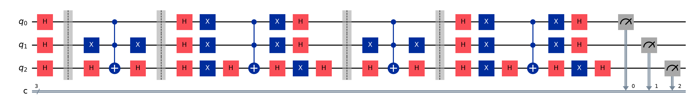
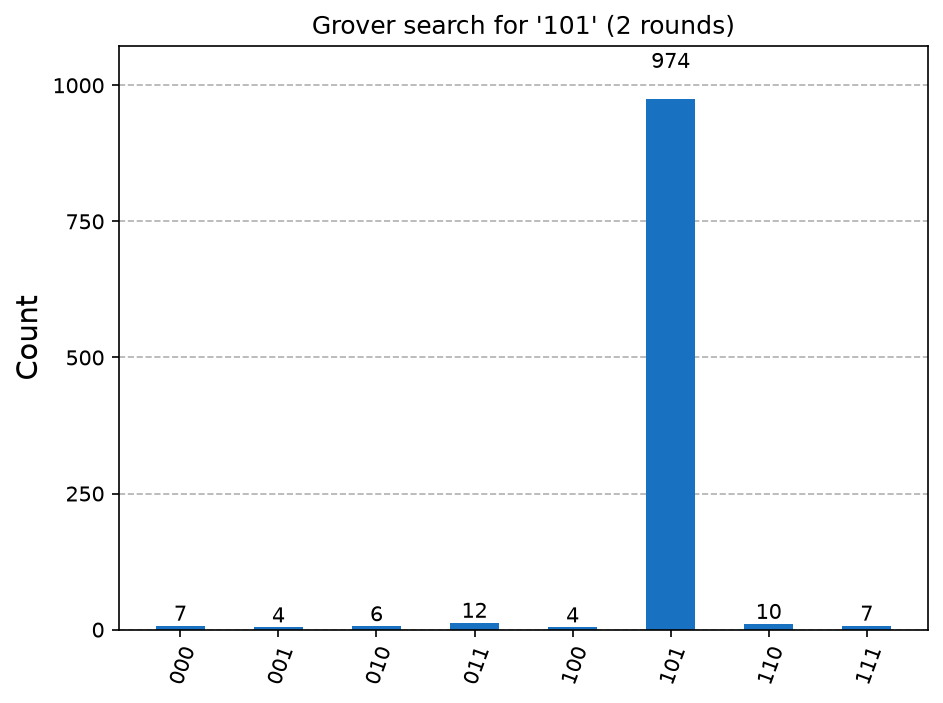

# Project 5: Grover's search on 3 qubits

## What it shows
Three qubits hold 8 possible items (000 to 111) and one is marked. Grover's algorithm makes the marked item very likely to come out of a single measurement. A second chart shows what happens when you use too many rounds.

## The physics, simply
We start with all 8 items equally likely, a 12.5% chance each. The oracle flips the sign of the marked item only. Its probability does not change yet, but its phase does. The diffuser reflects every amplitude around the average, which grows the marked one and shrinks the rest. One oracle-plus-diffuser round is one Grover iteration, and about (π/4)·√N rounds is ideal: 2 rounds for 8 items. For a large list that is roughly √N steps instead of N, a quadratic speedup. Extra rounds overshoot: the chance rises and falls in waves, so stopping at the right round matters.

## How to run it
From this folder, with your virtual environment active (see [SETUP_GUIDE.md](../SETUP_GUIDE.md)):

```
python grover_search.py         (searches for 101)
python grover_search.py 011     (search for any 3-bit item)
```

The script prints the results and saves circuit.png, histogram.png, rounds.png in this folder.

## Expected output
After 2 rounds the marked item 101 shows up in about 94-95% of shots, against 12.5% for a random guess. The rounds chart peaks at 0.945 after 2 rounds, crashes to 0.33 after 3 and 0.012 after 4, then climbs again (a wave).

## A real run (Qiskit 2.6.1, Qiskit Aer 0.18.0 simulator, 1,024 shots unless stated)
```
Searching 8 items for '101' using 2 Grover rounds
Found '101' in 974/1024 shots (95.1%). Random guessing would give 12.5%.
Chance of the marked item after 0..6 rounds: [0.125, 0.781, 0.945, 0.33, 0.012, 0.548, 1.0]
```
Your numbers will differ slightly each run, because measurement is random. The full terminal output, circuit included, is in `run_output.txt`.






## Try this next
Mark two items at once (change the oracle) and work out the new best number of rounds. Or scale to 4 qubits (16 items, 3 rounds) and run it on real hardware to see how noise grows with circuit depth.

## Post it
See [caption.md](caption.md).
