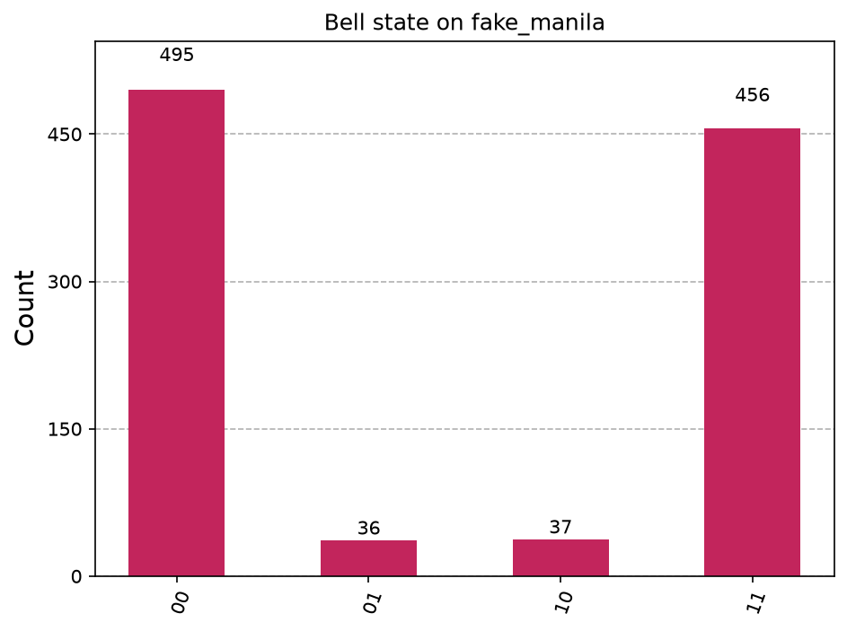

# Bonus: run the Bell state on a real IBM quantum computer

This runs Project 2 (the Bell state) on a real IBM quantum processor through IBM Quantum Platform's free Open Plan.

## Practice first, no account needed
```
python run_on_ibm.py --fake
```
`--fake` uses a built-in noisy copy of a retired 5-qubit IBM chip, running on your laptop. A real run on this box gave:
```
Running on: fake_manila
Counts: {'00': 495, '01': 36, '10': 37, '11': 456}
Qubits agreed in 92.9% of shots (a perfect, noise-free machine would give 100%; real chips have a little noise)
```
Unlike the perfect simulator in Project 2, a few shots now land on 01 and 10. That is hardware-style noise, and it is what real chips look like.



## Then the real thing
1. Follow Part 3 of [SETUP_GUIDE.md](../SETUP_GUIDE.md) to create a free account, an Open Plan instance and an API key, and save them once.
2. Run `python run_on_ibm.py`. It picks the least busy real chip, prints a job ID and waits. A queue of a few minutes or longer is normal.
3. It saves `hardware_histogram.png`. Post it next to your simulator chart: "perfect simulator vs real hardware" is a strong post.

A small 2-qubit job like this uses only a small slice of the free time. The Workloads page on the platform shows exactly how much each job used.
