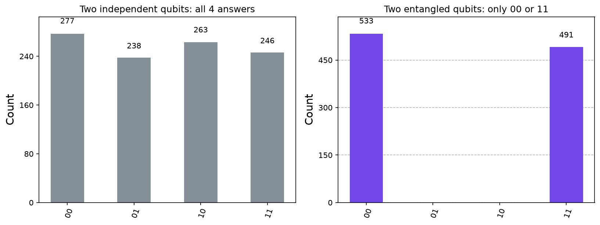
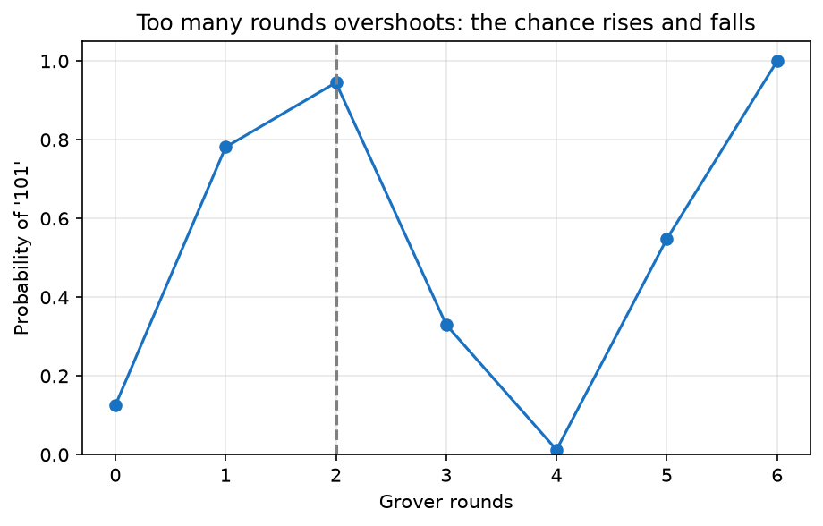

# quantum-journey

**Nigerian CS grad learning quantum computing in public.**

I'm Benjamin Akinade, a computer science graduate in Lagos. I'm learning quantum computing one small, working project at a time and sharing every step here and on X. Each project runs on a laptop with Python and Qiskit, and builds on the one before it.

## The projects

| # | Project | Ideas it teaches |
|---|---------|------------------|
| 1 | [Quantum coin flip](01-quantum-coin-flip/) | superposition, measurement |
| 2 | [Bell state (entanglement)](02-bell-state-entanglement/) | entanglement, CNOT |
| 3 | [Quantum teleportation](03-quantum-teleportation/) | entanglement + classical bits, mid-circuit measurement |
| 4 | [Bernstein-Vazirani](04-bernstein-vazirani/) | oracles, phase kickback, interference |
| 5 | [Grover's search](05-grover-search/) | amplitude amplification |
| bonus | [Run on real IBM hardware](06-run-on-real-hardware/) | noise, real QPUs, the free Open Plan |

Every folder has the script (commented line by line), a README with the physics in plain English, the images the code produced, a real run's output, and a "try this next" idea.

## Quick start
```
python -m venv .venv
.venv\Scripts\activate        (Mac/Linux: source .venv/bin/activate)
pip install -r requirements.txt
cd 01-quantum-coin-flip
python coin_flip.py
```
New to Python on Windows? Start with [SETUP_GUIDE.md](SETUP_GUIDE.md).

## Tested with
Python 3.11, Qiskit 2.6.1, Qiskit Aer 0.18.0, qiskit-ibm-runtime 0.51.0, matplotlib 3.11 (October 2026). All five projects and the bonus `--fake` mode ran cleanly.

## Highlights





## What's next
More algorithms (Deutsch-Jozsa, QFT, phase estimation), the same circuits on real hardware, and notes on what I get wrong along the way. Suggestions and corrections are welcome. Open an issue or reach me on X.
